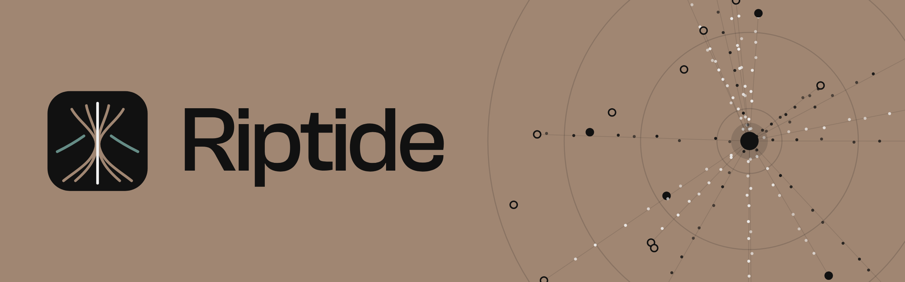

<p align="center">
  
</p>

<p align="center"><b>A quick, modern BitTorrent client.</b></p>

Riptide is a desktop BitTorrent client and an alternative to apps like qBittorrent and Transmission. It runs on [Undercurrent](https://github.com/Benzo-Fury/Undercurrent), a BitTorrent engine written in Rust.

## Why Riptide

- **Fast.** Riptide's engine downloads and seeds faster than any BitTorrent engine we tested. 
- **Light on CPU.** It uses less CPU per GB downloaded than qBittorrent.
- **Private.** It can lock all traffic to your VPN, and it stops if the VPN drops.
- **Simple.** It has a clean, modern interface that covers everything you'd expect from a torrent client.

## Speed

Riptide is quick, but for most people it won't make downloads finish sooner. Here's why.

### Benchmarks

Riptide and qBittorrent 5.0.5 on a MacBook Air (Apple M4), on the same machine with no internet involved. That takes the network out of the way, so the test shows what each app can do at most.

| | Riptide | qBittorrent |
|---|---|---|
| Download a 4 GiB file from 4 local seeders | 4.9–13.7 Gbit/s | 3.9–7.6 Gbit/s |
| CPU per GB downloaded | 1.07 s | 1.55 s |
| Seed to 8 local downloaders | 86–88 Gbit/s | 54 Gbit/s |
| CPU per GB seeded | 0.33 s | 0.34 s |
| Memory at idle, no torrents (whole app) | 124 MB | 84 MB |
| CPU at idle, no torrents (whole app) | 15 ms per second | 2.7 ms per second |

Three runs each, in alternating order. Download speeds varied a lot from run to run for both apps. Riptide was faster in two of the three runs. Seeding was steady. Riptide's idle figures are from a development build and include its web view's processes. To run the benchmark yourself, see [`bench/bench.ts`](bench/bench.ts). Raw results are in [`bench/results`](bench/results).

For the engine on its own against libtorrent, Transmission, rqbit, aria2 and others, see [Undercurrent's benchmarks](https://github.com/Benzo-Fury/Undercurrent/blob/main/docs/BENCHMARKS.md).

### Will it make my downloads faster?

Probably not. The speeds above are many times faster than most internet connections. The world's median home broadband connection is about 125 Mbit/s. qBittorrent can already handle far more than that, so on most connections both apps download at the same speed.

When a torrent is slow, the cause is usually one of these:

- **Not enough seeders.** A download can't go faster than the people uploading it. Many torrents have few seeders, or none.
- **Your connection.** If you're already using all of your bandwidth, no client can go faster.
- **Closed ports or carrier-grade NAT.** If other peers can't connect to you, you reach fewer of them.
- **A VPN that caps your speed.**

A faster client doesn't fix any of these. Riptide can be faster when the client itself is the limit:

- your connection is faster than your current client can fill,
- your computer is slow or busy,
- the torrent has thousands of small files,
- or the peers are far away.

### Would seeding with Riptide speed up swarms?

Mostly no. A seeder's upload is capped by its connection, and on home connections that cap is far below what either app can push. Swarms are faster with Riptide seeders only where the seeder's software is the limit, such as seedboxes on very fast links or low-power machines like a NAS.

## Limitations

- **No uTP.** Riptide connects over TCP only, so it can't reach peers that accept only uTP. See [why](https://github.com/Benzo-Fury/Undercurrent/blob/main/docs/HOW-IT-WORKS.md#why-not-utp).
- **Higher idle cost than qBittorrent.** The interface runs in a web view and the backend in Bun. Together they use more memory and CPU at idle than qBittorrent does.
- **More memory while downloading.** Riptide holds each piece in memory until it's complete, so data is written to disk once. A torrent can use up to 512 MB. You can change this in **Settings → Performance**.
- **No file priorities or streaming yet.** You can choose which files to download, but not their order.

## Building from source

Riptide is built with Rust and [Electrobun](https://electrobun.dev), so it runs on every platform Electrobun supports.

You'll need:

- [Bun](https://bun.sh)
- Rust 1.85 or newer
- [Undercurrent](https://github.com/Benzo-Fury/Undercurrent) cloned next to this folder

```sh
git clone https://github.com/Benzo-Fury/Undercurrent.git
git clone https://github.com/Benzo-Fury/Riptide.git
cd Riptide
bun install
bun run build    # the app lands in build/
```

The build downloads the interface's fonts, Satoshi and Clash Grotesk, from [Fontshare](https://www.fontshare.com). Their license doesn't allow them to be shared from this repository.

## Development

```sh
bun run dev        # build and run a development copy of the app
bun run dev:hmr    # the same, with hot reload for the interface
bun run test       # engine, backend and interface tests
bun run typecheck
```

| Folder | What's in it |
|---|---|
| `src/bun` | The app's backend: windows, menus, and talking to the engine |
| `src/mainview` | The interface, in React |
| `engine` | `undercurrentd`, the engine process that wraps Undercurrent |
| `tests` | Engine, backend and interface tests |
| `bench` | The benchmark above |

## Documentation

- [Features](docs/FEATURES.md): what's been built, what hasn't yet, and why.
- [Design](docs/DESIGN.md): the visual and motion design.
- [Undercurrent](https://github.com/Benzo-Fury/Undercurrent): the engine, how it works, and its benchmarks.
